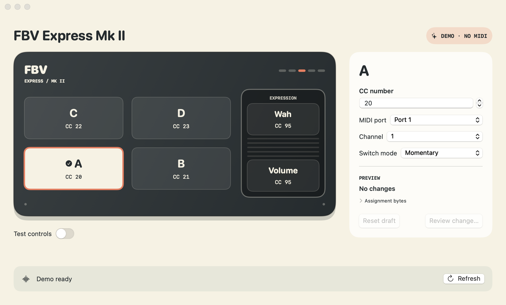

# FBV assignment studio

Configure MIDI CC assignments on your Line 6 FBV Express Mk II from your Mac.

## Download

[Download v1.0.1 for Apple silicon](https://github.com/jemmyw/FBVExpressMKIIControl/releases/download/v1.0.1/FBV-1.0.1-arm64.zip)

Requires **macOS 13 or later and an Apple silicon Mac**. Unzip and move `FBV.app`
to Applications. The app and included `fbv` command-line tool are Developer
ID-signed and notarised. Intel Macs are not supported by this release.

Supports CC assignments for A–D, Wah and Volume. See
[supported scope and limitations](ARCHITECTURE.md#assignment-transaction-and-protocol-limits).

## Technical details

MIT licensed. The download includes `LICENSE` and `fbv`; run `./fbv --help` for CLI usage.
[Architecture](ARCHITECTURE.md) covers components, state flow, protocol safeguards,
and build/test commands.
